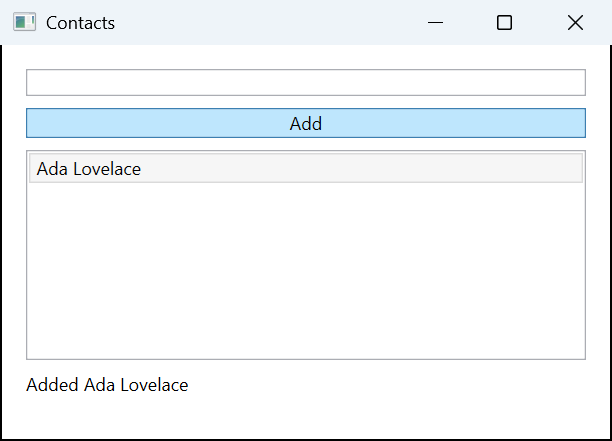
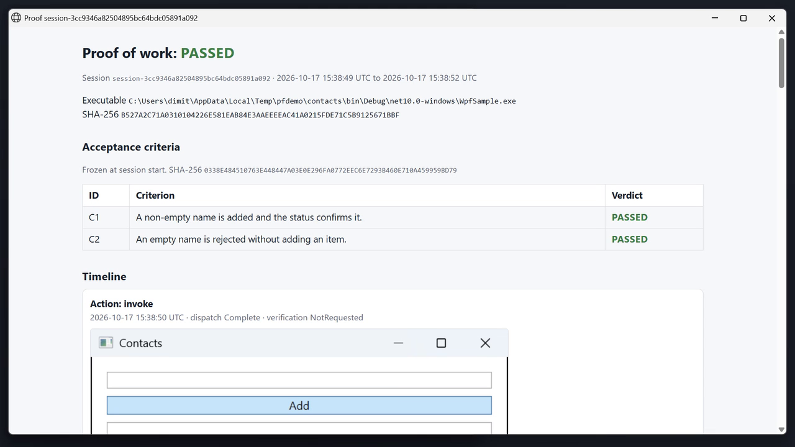

<p align="center">
  <a href="https://dimitar-radenkov.github.io/Pointframe/">
    
  </a>
</p>

<h1 align="center">Pointframe</h1>

<p align="center">
  <b>Let your coding agent test the real Windows UI.</b><br>
  Pointframe lets agents inspect your app, interact with its controls, and run repeatable checks with screenshots and signed evidence.<br>
  Free, open source, Windows x64.
</p>

<p align="center">
  <b><a href="#set-up-your-agent">Set up your agent</a></b> &nbsp;|&nbsp;
  <b><a href="#download-the-screenshot-app">Download the screenshot app</a></b>
</p>

**Coding agents:** read [the complete Windows desktop verification recipe](docs/cli/verify.md#coding-agents-start-here) before starting.

## An agent checks its UI change in the real app

`pointframe verify run` runs your build and test gates and, for each scenario in the spec, launches your built app, drives it through its real controls (invoke, type, check), and writes a verdict with a signed evidence bundle: `report.json`, `evidence/` screenshots and an `index.html`. A good scenario also carries a negative control, a check with a deliberately wrong expectation that must fail.

<p align="center">
  
</p>

<p align="center">
  <a href="https://dimitar-radenkov.github.io/Pointframe/verify-demo.mp4"></a>
</p>

<p align="center"><sub>30-second demo on the same sample: fail, fix, pass, evidence. Click to watch.</sub></p>

This is a real evidence screenshot from a passing run of the [WPF sample](samples/verify/wpf) (its [reference spec](samples/verify/wpf/reference/verify.json) is in the repo, so you can reproduce it).

## Pick your door

| I want to... | Use | First example |
|---|---|---|
| Give my agent eyes on the desktop, and optionally hands | [MCP server](docs/mcp/README.md) | Ask the agent to list your displays; it calls `list_displays` |
| Script captures, OCR and recordings, or gate an agent on a verified pass | [CLI](docs/cli/README.md) | `pointframe displays`, then `pointframe verify run` |
| Capture, annotate and record by hand | [Desktop app](docs/app.md) | Press `Print Screen` |

The CLI and the MCP server run on their own: neither needs the tray app. Capture, OCR and recording only observe. Interacting with an app's controls is off until you set it up for one app (`pointframe verify setup`, or a policy file; see [desktop testing](docs/mcp-desktop-testing/README.md)).

### What the MCP server gives an agent

Eleven always-on tools: `list_displays`, `list_windows`, `capture_monitor`, `capture_window`, `read_text_from_monitor`, `read_text_from_window`, `search_captures`, `get_capture`, `start_recording`, `stop_recording` and `get_recording_status`. Captures come back inline as an image plus a PNG on disk with SHA-256, monitor geometry and DPI. The opt-in `desktop_*` tools launch an approved app, click, type and check its UI, and write a signed report. Details: [MCP reference](docs/mcp/README.md#mcp-capabilities).

### What the CLI gives a script

```powershell
pointframe displays
pointframe windows
pointframe capture --monitor '\\.\DISPLAY1' --output .\shot.png
pointframe ocr --monitor '\\.\DISPLAY1'
pointframe record --monitor '\\.\DISPLAY1' --seconds 10 --output .\take1.mp4
pointframe verify run
```

The discovery, capture, OCR and recording commands write a single-line JSON response to standard output, on success and on failure. Exit code `0` is success and `1` a runtime failure with a stable `Error.Code`. Invalid command-line arguments exit `2` and write usage text to standard error instead of JSON. For other commands, follow their command-specific output contracts in the [CLI reference](docs/cli/README.md) and the [verify docs](docs/cli/verify.md). `pointframe mcp serve` speaks the MCP stdio protocol. `record` needs `ffmpeg.exe`. Every command and flag: [CLI reference](docs/cli/README.md#commands).

## Quick start

### Set up your agent

- **Claude Code plugin.** From a clone, `claude --plugin-dir ./plugin/pointframe` starts the MCP server and adds the `verify-desktop-work` skill ([plugin README](plugin/pointframe/README.md)). The plugin is not yet in the plugin directory.
- **Other MCP clients** (Claude Desktop, Codex, Cursor, VS Code): [connect your MCP client](docs/mcp/README.md#connect-your-mcp-client).
- **CLI.** Download `Pointframe.Cli-win-x64.zip` from the [latest release](https://github.com/dimitar-radenkov/Pointframe/releases/latest), extract it, and run this from that folder (checksum step: [CLI install](docs/cli/README.md#install)). Open a new terminal afterwards, so the user `Path` change takes effect. Then `pointframe displays` lists your monitors, and the [verify guide](docs/cli/verify.md) covers your own app.

```powershell
.\Pointframe.Cli.exe install
```

### Download the screenshot app

```powershell
winget install DimitarRadenkov.Pointframe
```

Press `Print Screen` to capture a region, add arrows, text or blur, then copy, save, pin or record. Or take the installer from [Releases](https://github.com/dimitar-radenkov/Pointframe/releases). Features, settings and shortcuts: [desktop app guide](docs/app.md).

## FAQ

**Does it need the desktop app?** No. The CLI and the MCP server are standalone: no tray app and no .NET runtime. The desktop app is the separate screenshot tool for people.

**Can it run headless?** Build and test gates can, including in CI. Checks of the real UI need an unlocked, interactive Windows session; a Windows service in session 0 cannot capture the user desktop.

**What does a pass establish?** That the gates and scenarios your spec configures all passed. A spec with only gates passes without launching an app, so UI coverage is only what your scenarios check. Trust a pass only when `pointframe verify status` reports `fresh: true`. Freshness covers the Git-visible working tree, the spec and the active-task snapshot. A spec with scenarios but no gates can pass but is never fresh (`no_build_gate`). Files ignored by `.gitignore` and verify's own output are not counted. It does not prove your code is correct.

## Privacy and telemetry

Official release builds of the CLI and the MCP server send anonymous usage counts (command or tool name, outcome, duration bucket, `host`, MCP client type, version, a random install ID), never screenshots, text or paths. Opt out with `POINTFRAME_TELEMETRY_OPTOUT=1` or `DO_NOT_TRACK=1`; this applies to the CLI and the MCP server only. The desktop app's official builds send the events listed in [PRIVACY.md](PRIVACY.md), which holds the full policy; source builds send nothing.

## Links

[CLI reference](docs/cli/README.md) | [MCP reference](docs/mcp/README.md) | [Desktop app guide](docs/app.md) | [Verify docs](docs/cli/verify.md) | [Developer guide](docs/developer-guide.md) | [Privacy](PRIVACY.md) | [Contributing](CONTRIBUTING.md) | [Releases](https://github.com/dimitar-radenkov/Pointframe/releases) | [Website](https://dimitar-radenkov.github.io/Pointframe/)

If you find Pointframe useful, a star on GitHub helps others discover it.

<p align="center">
  <a href="https://github.com/dimitar-radenkov/Pointframe/actions/workflows/ci.yml"></a>
  <a href="https://codecov.io/gh/dimitar-radenkov/Pointframe"></a>
  <a href="https://github.com/dimitar-radenkov/Pointframe/releases/latest"></a>
  <a href="https://github.com/microsoft/winget-pkgs/tree/master/manifests/d/DimitarRadenkov/Pointframe"></a>
  <a href="https://github.com/dimitar-radenkov/Pointframe/releases"></a>
  <a href="https://github.com/dimitar-radenkov/Pointframe/releases/latest/download/Pointframe.Cli-win-x64.zip"></a>
  <a href="https://github.com/dimitar-radenkov/Pointframe/releases/latest/download/Pointframe.Mcp-win-x64.mcpb"></a>
</p>

<p align="center">
  <b>If Pointframe saves you time, consider <a href="https://paypal.me/DimitarRadenkov">buying me a beer</a>:</b><br>
  <a href="https://paypal.me/DimitarRadenkov"></a>
  <a href="https://revolut.me/dimitarradenkov"></a>
</p>

## Moved sections

Older links point to these headings. The content now lives in its own file.

### Pointframe MCP Server

Moved to the [MCP reference](docs/mcp/README.md).

### Privacy Policy

Moved to [PRIVACY.md](PRIVACY.md#privacy-policy).

### Privacy & Telemetry

Moved to [PRIVACY.md](PRIVACY.md#privacy--telemetry).
