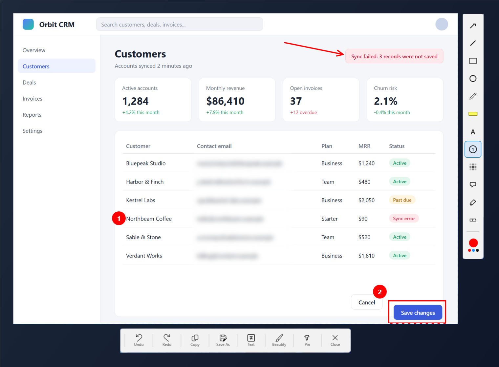
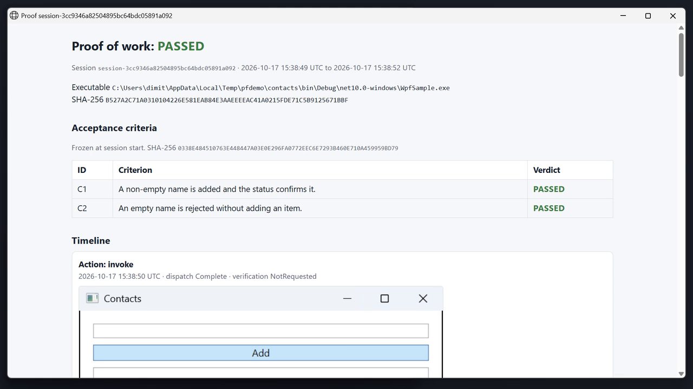

<p align="center">
  <a href="https://dimitar-radenkov.github.io/Pointframe/">
    
  </a>
</p>

<h1 align="center">Pointframe</h1>

<p align="center">
  <b>Screen capture, annotation and recording for Windows, and the same desktop eyes and hands for AI agents.</b><br>
  A tray app for people, an MCP server for coding agents, and a CLI for scripts. Free, open source, Windows x64.
</p>

<p align="center">
  <a href="https://github.com/dimitar-radenkov/Pointframe/releases"></a>
  <a href="https://github.com/dimitar-radenkov/Pointframe/releases/latest/download/Pointframe.Mcp-win-x64.mcpb"></a>
  <a href="https://github.com/dimitar-radenkov/Pointframe/releases/latest/download/Pointframe.Cli-win-x64.zip"></a>
  <a href="https://github.com/dimitar-radenkov/Pointframe/releases/latest"></a>
  <a href="https://github.com/microsoft/winget-pkgs/tree/master/manifests/d/DimitarRadenkov/Pointframe"></a>
</p>

<p align="center">
  <b><a href="#download-the-screenshot-app">Desktop app</a></b> &nbsp;|&nbsp;
  <b><a href="#mcp-server-for-ai-agents">MCP server</a></b> &nbsp;|&nbsp;
  <b><a href="#cli-for-scripts-and-ci">CLI</a></b> &nbsp;|&nbsp;
  <b><a href="#set-up-your-agent">Set up your agent</a></b> &nbsp;|&nbsp;
  <b><a href="https://dimitar-radenkov.github.io/Pointframe/">Website</a></b>
</p>

<p align="center">
  
</p>

**Coding agents:** read [the complete Windows desktop verification recipe](docs/cli/verify.md#coding-agents-start-here) before starting.

## One engine, three ways to use it

| | Desktop app | MCP server | CLI |
|---|---|---|---|
| **For** | People who share screenshots and recordings | AI coding agents (Claude Code, Codex, Cursor, VS Code) | Scripts, CI and agents that prefer a shell |
| **Does** | Capture, annotate, blur, OCR, pin and record to MP4 or GIF | Lets an agent see the screen, read text, record, and drive an approved app's UI | The same captures, OCR, recordings and `verify run` as JSON commands |
| **Get it** | `winget install DimitarRadenkov.Pointframe` | [Connect your MCP client](docs/mcp/README.md#connect-your-mcp-client) | [Install the CLI](docs/cli/README.md#install) |

The CLI and the MCP server are standalone: no tray app, no .NET runtime. They only observe until you approve one app for interaction (`pointframe verify setup`; see [desktop testing](docs/mcp-desktop-testing/README.md)).

## Desktop app

Press `Print Screen`, draw a region, mark it up and share it. The screen freezes the moment you press the key, so menus and tooltips stay exactly as they were.

- **Annotate:** arrow, line, rectangle, circle, pen, highlighter, text, numbered steps, callout, color picker and a pixel ruler, with style presets and full undo and redo.
- **Hide what is private:** drag a blur over emails, passwords or tokens before you share.
- **Copy text from anything:** lasso text on screen, even inside an image or a video, and Pointframe copies it with OCR.
- **Record:** a region or the whole screen to MP4 or GIF, with microphone audio and annotations drawn live while you record. Trim the result from the tray.
- **Keep and reuse:** pin a capture as an always-on-top window, frame it with the Beautifier, search old captures by their text in the Capture Library, or upload and copy a link.

### Download the screenshot app

```powershell
winget install DimitarRadenkov.Pointframe
```

Or take the installer from [Releases](https://github.com/dimitar-radenkov/Pointframe/releases). Features, settings and shortcuts: [desktop app guide](docs/app.md).

## MCP server for AI agents

Give your coding agent eyes on the Windows desktop, and, for an app you approve, hands. Eleven always-on tools list displays and windows, capture a monitor or a window, read text with OCR, search past captures and record (`capture_window`, `read_text_from_monitor`, `start_recording`, ...). Captures come back inline as an image plus a PNG on disk with SHA-256, monitor geometry and DPI. The opt-in `desktop_*` tools launch an approved app, click, type and check its UI, and write a signed report. Details: [MCP reference](docs/mcp/README.md#mcp-capabilities).

### An agent checks its UI change in the real app

`pointframe verify run` runs your build and test gates and, for each scenario in the spec, launches your built app, drives it through its real controls (invoke, type, check), and writes a verdict with a signed evidence bundle: `report.json`, `evidence/` screenshots and an `index.html`.

<p align="center">
  <a href="https://dimitar-radenkov.github.io/Pointframe/verify-demo.mp4"></a>
</p>

<p align="center"><sub>30-second demo on the <a href="samples/verify/wpf">WPF sample</a>: fail, fix, pass, evidence. Click to watch.</sub></p>

## CLI for scripts and CI

```powershell
pointframe displays
pointframe windows
pointframe capture --monitor '\\.\DISPLAY1' --output .\shot.png
pointframe ocr --monitor '\\.\DISPLAY1'
pointframe record --monitor '\\.\DISPLAY1' --seconds 10 --output .\take1.mp4
pointframe verify run
```

Discovery, capture, OCR and recording commands print one JSON line on standard output, on success and on failure: exit `0` is success, `1` a runtime failure with a stable `Error.Code`, `2` invalid arguments (usage on standard error). `pointframe mcp serve` speaks the MCP stdio protocol; `record` needs `ffmpeg.exe`. Every command, flag and output contract: [CLI reference](docs/cli/README.md#commands) and [verify docs](docs/cli/verify.md).

## Quick start

### Set up your agent

- **Claude Code plugin.** From a clone, `claude --plugin-dir ./plugin/pointframe` starts the MCP server and adds the `verify-desktop-work` skill ([plugin README](plugin/pointframe/README.md)). The plugin is not yet in the plugin directory.
- **Other MCP clients** (Claude Desktop, Codex, Cursor, VS Code): [connect your MCP client](docs/mcp/README.md#connect-your-mcp-client).
- **CLI.** Download `Pointframe.Cli-win-x64.zip` from the [latest release](https://github.com/dimitar-radenkov/Pointframe/releases/latest), extract it, and run this from that folder, then open a new terminal ([CLI install](docs/cli/README.md#install), [verify guide](docs/cli/verify.md)).

```powershell
.\Pointframe.Cli.exe install
```

## FAQ

**Can it run headless?** Build and test gates can, including in CI. Checks of the real UI need an unlocked, interactive Windows session; a Windows service in session 0 cannot capture the user desktop.

**What does a pass establish?** That the gates and scenarios your spec configures passed; UI coverage is only what your scenarios check. Trust a pass only when `pointframe verify status` reports `fresh: true` (it covers the Git-visible tree, the spec and the active task). It does not prove your code is correct. Details: [verify docs](docs/cli/verify.md).

## Privacy and telemetry

Official release builds of the CLI and the MCP server send anonymous usage counts (command or tool name, outcome, duration bucket, `host`, MCP client type, version, a random install ID), never screenshots, text or paths. Opt out with `POINTFRAME_TELEMETRY_OPTOUT=1` or `DO_NOT_TRACK=1`; this applies to the CLI and the MCP server only. The desktop app's official builds send the events listed in [PRIVACY.md](PRIVACY.md), which holds the full policy; source builds send nothing.

## Links

[CLI reference](docs/cli/README.md) | [MCP reference](docs/mcp/README.md) | [Desktop app guide](docs/app.md) | [Verify docs](docs/cli/verify.md) | [Developer guide](docs/developer-guide.md) | [Privacy](PRIVACY.md) | [Contributing](CONTRIBUTING.md) | [Releases](https://github.com/dimitar-radenkov/Pointframe/releases) | [Website](https://dimitar-radenkov.github.io/Pointframe/)

If you find Pointframe useful, a star on GitHub helps others discover it.

<p align="center">
  <a href="https://github.com/dimitar-radenkov/Pointframe/actions/workflows/ci.yml"></a>
  <a href="https://codecov.io/gh/dimitar-radenkov/Pointframe"></a>
</p>

<p align="center">
  <b>If Pointframe saves you time, consider <a href="https://paypal.me/DimitarRadenkov">buying me a beer</a>:</b><br>
  <a href="https://paypal.me/DimitarRadenkov"></a>
  <a href="https://revolut.me/dimitarradenkov"></a>
</p>

## Moved sections

Older links point to these headings. The content now lives in its own file.

### Pointframe MCP Server

Moved to the [MCP reference](docs/mcp/README.md).

### Privacy Policy

Moved to [PRIVACY.md](PRIVACY.md#privacy-policy).

### Privacy & Telemetry

Moved to [PRIVACY.md](PRIVACY.md#privacy--telemetry).
